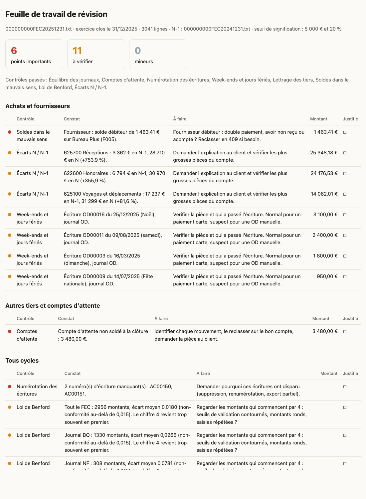
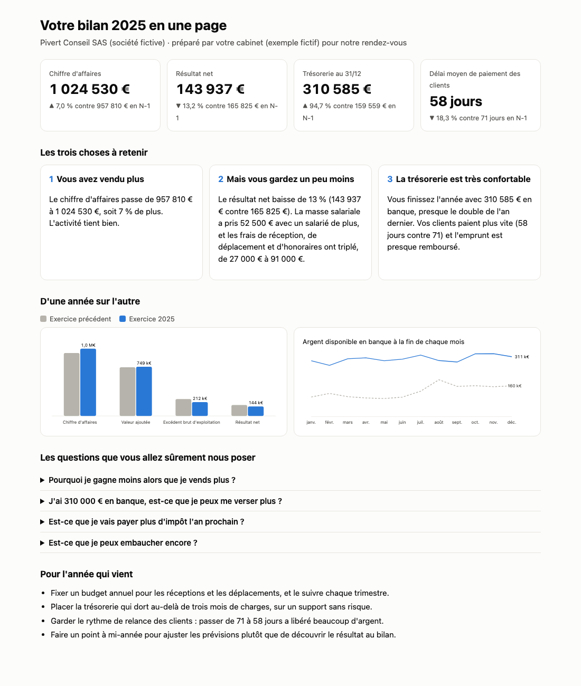

# Skills Claude pour l'expert-comptable

Cinq assistants pour l'expert-comptable qui tient un portefeuille de clients et leur parle tous les jours. Ils préparent, vous décidez : **aucun skill n'envoie, ne déclare ni ne paie quoi que ce soit**. Tout ce qu'ils produisent est un brouillon que vous relisez.

Ils marchent avec de simples fichiers (FEC, relevé bancaire, tableau Excel, mail collé). Pas besoin de brancher votre logiciel pour essayer : comptez cinq minutes avec les exemples fournis.

## Les cinq skills

| Skill | Ce qu'il fait | Vous lui donnez | Il vous rend |
|---|---|---|---|
| **reponse-client** | Rédige la réponse à une question de client, avec la règle, sa source officielle et son niveau de certitude | Le mail du client | Un brouillon de réponse et une note pour vous (source, certitude, infos manquantes) |
| **relance-pieces** | Trouve les justificatifs qui manquent et prépare la relance | Le relevé bancaire et la liste des pièces reçues | Les pièces manquantes, de la plus grosse à la plus petite, et le mail de relance |
| **revision-dossier** | Passe le FEC aux contrôles de révision avant clôture | Le FEC (et celui de l'an dernier) | Une feuille de travail cycle par cycle, avec les points à justifier |
| **rendez-vous-bilan** | Prépare le rendez-vous bilan avec le client | Le FEC de clôture (et celui de l'an dernier) | Une page claire pour un non-comptable : chiffres clés, trois messages, graphiques, questions, conseils |
| **alerte-echeances** | Prévient chaque client de ce qui tombe ce mois-ci | Votre tableau de portefeuille | Le calendrier du mois, les trésoreries à surveiller, un message « prévoyez environ 4 200 € » par client |

## À quoi ça ressemble

**Révision du dossier** : un FEC entre, la feuille de travail sort. Sur le FEC d'exemple, le skill retrouve les neuf anomalies cachées exprès (compte d'attente non soldé, numéros d'écriture manquants, écritures un dimanche et à Noël, créance de 2024 jamais lettrée, client payé deux fois, découvert, honoraires qui explosent, notes de frais juste sous 500 €).



**Rendez-vous bilan** : la même comptabilité, racontée au client.



**Réponse client** : « je peux passer ce resto en frais ? » (extrait de la note pour l'expert-comptable et du brouillon) :

```text
Certitude : sûr pour la déduction (prospect identifié, montant raisonnable).
À confirmer pour la TVA : conclusion tirée de l'absence d'exclusion dans le BOFiP.

Bonjour Malik,
Oui, ce repas peut passer en frais de la société : vous avez invité un prospect
dans l'intérêt du garage, et le montant est raisonnable.
```

**Relance des pièces** (extrait du brouillon produit) :

```text
Pour avancer sur votre comptabilité de septembre 2026, il nous manque 8 justificatifs,
pour un total de 2 875,41 €. Les voici, du plus important au plus petit :

- le 22/09/2026, 1 331,82 € payé, libellé « VIR SEPA SCI QUAI NEUF LOYER » : facture d'achat ou ticket
- le 22/09/2026, 543,40 € payé, libellé « CB LAITERIE COOPERATIVE VAL » : facture d'achat ou ticket
```

**Alerte échéances** (extrait, décembre 2026) :

| Client | À payer (estimé) | Trésorerie connue | État |
|---|---|---|---|
| Garage Horizon (fictif) | 25 350 € | 14 300 € | 🔴 insuffisante |
| Menuiserie Carène (fictive) | 19 690 € | 42 100 € | suffisante |

Toutes les sorties d'exemple sont dans [exemples/sorties/](exemples/sorties/). Le déroulé de chaque démonstration est dans [docs/demos.md](docs/demos.md).

## Installer

### Dans Claude Code (deux commandes)

Dans Claude Code, tapez :

```text
/plugin marketplace add DanielSacksick/skills-expert-comptable
/plugin install skills-expert-comptable@skills-expert-comptable
```

Les cinq skills sont alors disponibles. Il suffit de demander, par exemple : « révise ce FEC » en glissant le fichier, ou « prépare les relances de septembre ».

Python 3.10 ou plus récent doit être installé sur l'ordinateur ([python.org](https://www.python.org/downloads/)). Aucun paquet supplémentaire n'est nécessaire.

### Dans Claude.ai

1. Téléchargez le fichier zip du skill voulu dans le dossier [zips/](zips/) (un zip par skill).
2. Dans Claude.ai, ouvrez **Personnaliser**, puis **Skills**, cliquez sur **+**, puis **Téléverser un skill**, et choisissez le zip.
3. Activez le skill. L'exécution de code doit être activée dans vos paramètres.
4. Dans une conversation, déposez votre fichier et demandez ce que vous voulez.

Les intitulés exacts du menu peuvent varier selon les versions de Claude.ai.

### Essayer en cinq minutes

Le dossier [exemples/](exemples/) contient des données **100 % fictives** : le FEC 2024 et 2025 d'une SAS de services imaginaire, deux relevés bancaires avec leurs justificatifs, un portefeuille de dix clients, et cinq mails de clients. Déposez-les et demandez :

- « Révise ce FEC, voici celui de l'an dernier » avec les deux fichiers de `exemples/fec/`.
- « Prépare mon rendez-vous bilan » avec les mêmes fichiers.
- « Quelles pièces manquent ? » avec le dossier `exemples/relance-pieces/`.
- « Quelles échéances en décembre 2026 ? » avec `exemples/portefeuille/portefeuille.csv`.
- « Réponds à ce client » avec un mail de `exemples/mails/`.

## Brancher vos outils (facultatif)

Les skills marchent sans aucun branchement. Si vous avez déjà connecté certains outils à Claude, ils en profitent :

| Outil | Ce que ça change |
|---|---|
| Pennylane (connecteur officiel, lecture seule) | Lire la balance ou le grand livre d'un dossier sans export |
| Qonto (connecteur officiel) | Lire les transactions et les justificatifs déjà attachés, à la place du relevé |
| Gmail, Outlook | Lire le mail du client, déposer la réponse ou la relance **en brouillon** dans votre boîte |
| Google Drive, OneDrive, SharePoint | Trouver le FEC, les pièces ou le portefeuille là où ils sont rangés |

L'état des lieux complet (Cegid, ACD, Sage, Tiime, Inqom, MyUnisoft, banques, administrations) est dans [docs/connecteurs.md](docs/connecteurs.md). En résumé : aucune administration (impots.gouv, net-entreprises, URSSAF) n'offre d'accès ouvert à un assistant, c'est pourquoi les skills préparent et vous déposez.

## Vos données et le secret professionnel

- Les fichiers de vos clients sont couverts par le secret professionnel et par le RGPD. Avant de les déposer, assurez-vous que l'outil que vous utilisez est validé par votre cabinet (offre professionnelle, conditions de traitement des données, pas d'entraînement sur vos données).
- Dans le doute, pseudonymisez : remplacez les noms de clients, de salariés et de tiers par des codes avant de déposer un fichier.
- Ne collez jamais de données réelles dans une conversation que vous ne maîtrisez pas.
- Les skills ne gardent rien : ils écrivent leurs résultats dans des fichiers sur votre ordinateur (Claude Code) ou dans la conversation (Claude.ai).

## Ce qu'ils ne font pas (les limites)

- **Ils ne remplacent pas votre jugement.** Un point de révision n'est pas une erreur certaine, un montant d'échéance est une estimation, une règle fiscale a un niveau de certitude affiché.
- **Les règles fiscales et sociales ont été vérifiées le 27 octobre 2026** sur Légifrance, le BOFiP, impots.gouv.fr et service-public.gouv.fr, avec les liens dans chaque skill. Une loi de finances peut tout changer : relisez les fichiers `references/` en début d'année. Deux changements récents sont déjà intégrés : la recodification de la TVA dans le Code des impositions sur les biens et services, et la fin du régime simplifié de TVA au 1er janvier 2027.
- **Plan comptable français uniquement.** Pas de comptabilité étrangère.
- **Les calculs passent par des scripts testés**, pas par l'intelligence artificielle : SIG, Benford, échéances, rapprochements. Mais la rédaction (réponse client, messages du bilan) est faite par Claude : relisez-la.
- Pas de simulation salaire contre dividendes, pas de liasse, pas de CVAE, pas d'échéances personnelles du dirigeant non salarié.

## Pour les curieux (et les développeurs)

- Chaque skill est un dossier `skills/<nom>/` avec ses instructions (`SKILL.md`), ses scripts Python (sans aucune dépendance) et ses références sourcées.
- Les tests vérifient les calculs sur des cas faits à la main et sur les exemples : `python -m pytest` (installer `pytest` avant).
- Les données d'exemple se régénèrent à l'identique : `python outils/generer_fec.py` et `python outils/generer_banque.py`.
- Plan du dépôt : [MAP.md](MAP.md).

## Licence

MIT. Utilisez, modifiez, partagez. Aucune garantie : ces outils aident à préparer, l'expert-comptable reste seul responsable de ce qu'il signe et de ce qu'il envoie.
